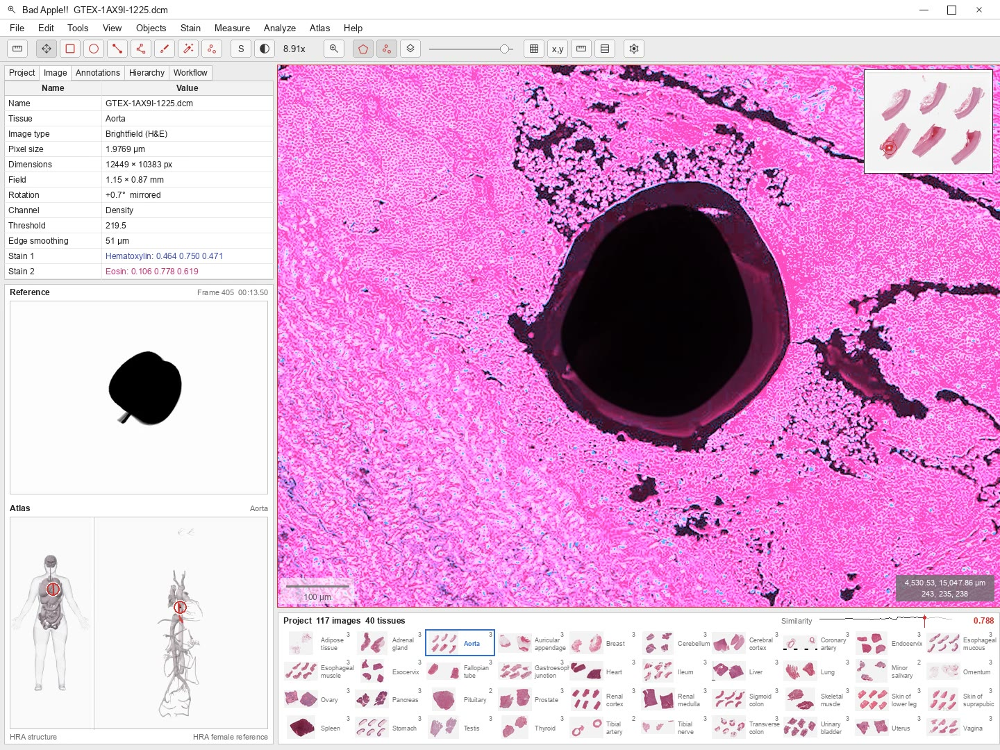

# Bad Apple!! but every frame is a histology slide



Every frame of Bad Apple!! is matched to the closest field of view in 117 H&E whole-slide images of normal human tissue, up to three from each of the 40 tissues sampled by the GTEx project, from brain and pituitary to lung, colon, kidney, skin and tibial nerve. The slides are public, de-identified and CC BY 4.0, from the NCI Imaging Data Commons.

The video is laid out like a slide-analysis workstation:
- **Viewport.** The matched field in real stain colour: brightfield when the figure is dark, virtual fluorescence (hematoxylin blue, eosin magenta, on black) when it is light.
- **Image table.** The slide's pixel size and dimensions, the field size, rotation, stain channel and threshold, and the slide's own hematoxylin and eosin stain vectors.
- **Overview.** The whole slide with the field's footprint.
- **Reference.** The original Bad Apple!! frame.
- **Atlas.** A 3D body from the Human Reference Atlas with the sampled organ lit and the tissue block where GTEx registered that sample, beside the organ on its own.
- **Project.** All 40 tissues, with the current slide outlined and the similarity as a small trace.

Two other layouts follow other slide viewers: a clinical slide tray (`--layout clinical`) and a full-screen scanner view (`--layout scanner`). See [the options](docs/previews/options.jpg).

## Quick start

Needs Python 3.11 to 3.13, FFmpeg and about 18 GB of disk: 5 GB of slides and anatomy, plus 12 GB of stain planes prepared on first use.

```sh
python3 -m venv .venv
.venv/bin/python -m pip install -r requirements.txt
.venv/bin/python -m pathapple fetch     # downloads and verifies the slides, anatomy and media
.venv/bin/python -m pathapple run       # matches and renders a 7-second excerpt
```

On an Apple M4 laptop the excerpt takes about 10 minutes to prepare the slides the first time, then 2.6 minutes of GPU search over 17.5 million fields, half a minute of refinement and under two minutes of rendering. Its mean similarity is 0.736, against 0.743 for the [MRI and CT edition](https://github.com/ethanuser/bad-apple-medical-scan) on the same seven seconds with seven times the search.

## More

- [Technical notes](docs/TECHNICAL.md): stain separation, search, scoring, display, anatomy and tests
- [Credits and licences](CREDITS.md)
